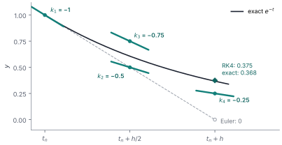

# Theory: Runge–Kutta methods (what ode45 does)

In the coil-current exercise you run the same model with two solvers. `ode1` is Euler, which you know from the [tritium exercise](../done/26-10-15_NUM-4.1_python/26-10-15_NUM-4.1_python.pdf). `ode45`, Simulink's default, is a **Runge–Kutta** method. This note explains what that means, why it is so much more accurate per step, and how `ode45` picks its own step size. Matching reading: Tao Pang, ch. 4 (the Runge–Kutta section).

The step size is called $h$ here, as in Simulink. The Euler note called it $\Delta t$.

## Why Euler is inaccurate
For $dy/dt = f(t, y)$, Euler takes the slope at the start of the step and uses it for the whole step:

$$y_{n+1} = y_n + h\,f(t_n, y_n)$$

But the slope changes during the step. In a decay the curve flattens as it goes, so the starting slope is the steepest one and Euler always undershoots. That is the $\tfrac12 h^2 y''$ term it drops every step.

What you really want is the *average* slope over the step. You can't know it exactly without the solution, but you can **estimate** it: evaluate $f$ at a few trial points inside the step and take a weighted average. That is the whole idea of Runge–Kutta. Each evaluation of $f$ is called a **stage**.

## RK2: one trial step to the middle
The midpoint method:

$$k_1 = f(t_n,\, y_n), \qquad k_2 = f\!\left(t_n + \tfrac{h}{2},\; y_n + \tfrac{h}{2}k_1\right), \qquad y_{n+1} = y_n + h\,k_2$$

In words: walk half a step with Euler, measure the slope there, then go back to the start and take the full step with that midpoint slope.

**Why it is second order (sketch).** The exact solution satisfies

$$y(t+h) = y + h\,y' + \tfrac{1}{2}h^2\,y'' + O(h^3), \qquad y' = f, \quad y'' = f_t + f_y\,f$$

(chain rule, since $y$ itself depends on $t$; $f_t$ and $f_y$ are partial derivatives). Expanding $k_2$ in powers of $h$ gives $k_2 = f + \tfrac{h}{2}(f_t + f_y f) + O(h^2)$, so

$$y_n + h\,k_2 = y + h\,f + \tfrac{1}{2}h^2\,(f_t + f_y f) + O(h^3)$$

This matches the exact expansion up to $h^2$. The local error is $O(h^3)$ and, by the same counting as for Euler, the global error is $O(h^2)$.

**Heun's method** (Simulink's `ode2`) is a sibling: take the trial step to the *end*, $k_2 = f(t_n + h,\, y_n + h k_1)$, and average, $y_{n+1} = y_n + \tfrac{h}{2}(k_1 + k_2)$. Also second order.

## RK4: the classic
$$\begin{aligned}
k_1 &= f(t_n,\, y_n) \\
k_2 &= f\!\left(t_n + \tfrac{h}{2},\; y_n + \tfrac{h}{2}k_1\right) \\
k_3 &= f\!\left(t_n + \tfrac{h}{2},\; y_n + \tfrac{h}{2}k_2\right) \\
k_4 &= f(t_n + h,\; y_n + h\,k_3) \\
y_{n+1} &= y_n + \tfrac{h}{6}\left(k_1 + 2k_2 + 2k_3 + k_4\right)
\end{aligned}$$

Read it as: the slope at the start, two estimates of the slope in the middle (the second built from the first, so it is better), and the slope at the end, combined in a weighted average. The weights $1, 2, 2, 1$ over $6$ are **Simpson's rule**, $\int_t^{t+h} g \approx \tfrac{h}{6}\left(g_\text{start} + 4g_\text{mid} + g_\text{end}\right)$, with the middle weight shared between the two midpoint estimates. If $f$ depends only on $t$, RK4 *is* Simpson's rule.

Those particular coefficients are what it takes to match the Taylor series up to $h^4$ (the algebra is long; Pang does the RK2 case). Local error $O(h^5)$, global error $O(h^4)$.

*One RK4 step of $y' = -y$ from $y = 1$, with a deliberately huge $h = 1$ so you can see it. Dots are the trial points, the short lines the slope measured at each. Euler follows $k_1$ the whole way and lands at 0. RK4's weighted average gives 0.375, against the exact 0.368.*

## How much better? Some numbers
Test problem $y' = -y$, $y(0) = 1$, exact solution $e^{-t}$.

**One step with $h = 0.1$** (exact $e^{-0.1} = 0.904837418$):

| Method | Stages | $y_1$ | Error |
|--------|--------|-------|-------|
| Euler | 1 | 0.900000000 | $4.8\times10^{-3}$ |
| RK2 (midpoint) | 2 | 0.905000000 | $1.6\times10^{-4}$ |
| RK4 | 4 | 0.904837500 | $8.2\times10^{-8}$ |

**Global error at $T = 1$**, the same convergence test as your tritium table:

| Method | $h = 0.1$ | $h = 0.05$ | $h = 0.025$ | Ratio | Order $p$ |
|--------|-----------|------------|-------------|-------|-----------|
| Euler | $1.92\times10^{-2}$ | $9.39\times10^{-3}$ | $4.65\times10^{-3}$ | ≈ 2 | 1 |
| RK2 | $6.62\times10^{-4}$ | $1.59\times10^{-4}$ | $3.91\times10^{-5}$ | ≈ 4 | 2 |
| RK4 | $3.33\times10^{-7}$ | $2.00\times10^{-8}$ | $1.22\times10^{-9}$ | ≈ 16 | 4 |

**Cost.** An RK4 step costs 4 evaluations of $f$, Euler's costs 1. But to get the error at $T = 1$ below $10^{-6}$, Euler needs about 184 000 steps, RK2 needs 248 steps (496 evaluations), and RK4 needs 8 steps (32 evaluations). On a smooth solution, higher order wins by a huge margin.

## Stability: higher order buys little
For $y' = -\lambda y$, every step of these methods multiplies $y$ by a fixed factor $R$ that depends only on $\lambda h$. With $z = -\lambda h$:

$$R_\text{Euler} = 1 + z, \qquad R_\text{RK2} = 1 + z + \tfrac{z^2}{2}, \qquad R_\text{RK4} = 1 + z + \tfrac{z^2}{2} + \tfrac{z^3}{6} + \tfrac{z^4}{24}$$

These are the Taylor series of the exact factor $e^{z}$, cut off after the $z^p$ term. That is what "order $p$" means for this equation. The numerical solution decays only if $|R| < 1$:

| $\lambda h$ | exact $e^{-\lambda h}$ | Euler | RK2 | RK4 |
|-------------|------------------------|-------|-----|-----|
| 0.5 | 0.607 | 0.500 | 0.625 | 0.607 |
| 1 | 0.368 | 0 | 0.500 | 0.375 |
| 2 | 0.135 | −1 | 1.000 | 0.333 |
| 2.5 | 0.082 | −1.5 | 1.625 | 0.648 |
| 3 | 0.050 | −2 | 2.500 | 1.375 |

So Euler and RK2 need $\lambda h < 2$, and RK4 needs $\lambda h < 2.785$. A step that costs 4× as much buys only about 40 % more room. Every explicit method has a limit like this. When stability rather than accuracy is what forces tiny steps, the problem is called **stiff**, and you switch to an implicit solver (`ode15s` in Simulink; NUM-4.7 later).

## What ode45 actually does
Fixed-step RK4 leaves two problems: you have to choose $h$ yourself, and you don't know how big your error is. `ode45` solves both.

**An embedded pair.** `ode45` is the **Dormand–Prince** method. Each step computes 7 stages, but the last one is reused as the first stage of the next step, so it costs 6 new evaluations of $f$. It then combines the *same* stages with two different sets of weights: one gives a 5th-order answer $y^{(5)}$, the other a 4th-order answer $y^{(4)}$. Their difference estimates the local error almost for free. That is the "45" in the name.

**Step-size control.** After each step the solver:
1. computes $\text{err} = |y^{(5)} - y^{(4)}|$ and compares it with the tolerance, roughly $\text{tol} = \max(\text{RelTol}\cdot|y|,\ \text{AbsTol})$. Simulink's default *Relative tolerance* is $10^{-3}$, and *Absolute tolerance* is `auto`;
2. if $\text{err} > \text{tol}$, rejects the step, shrinks $h$ and tries again;
3. otherwise accepts the step and picks the next $h$. The local error scales as $h^5$, so the step that would just meet the tolerance is about

$$h_\text{new} \approx 0.9\, h \left(\frac{\text{tol}}{\text{err}}\right)^{1/5}$$

with the 0.9 as a safety margin. The result: small steps where the solution changes fast (just after a switch-on), large steps where it is smooth (near steady state).

**What you will see because of this:**
- On a smooth curve `ode45` takes few, large steps, so the plot looks jagged even though every point is accurate. *Max step size* caps $h$, which gives more points; *Refine factor* adds interpolated output points between steps at almost no cost.
- The **tolerance** sets the accuracy, not $h$. Lowering *Relative tolerance* to $10^{-6}$ makes the result more accurate. Lowering *Max step size* mostly changes how many points you see.
- The tolerance is checked per step, so the global error can end up somewhat larger than RelTol.

## Simulink's solver list

| Solver | Method | Order | Step size |
|--------|--------|-------|-----------|
| `ode1` | Euler | 1 | fixed |
| `ode2` | Heun | 2 | fixed |
| `ode3` | Bogacki–Shampine | 3 | fixed |
| `ode4` | classic RK4 | 4 | fixed |
| `ode5` | Dormand–Prince | 5 | fixed |
| `ode23` | Bogacki–Shampine 3(2) pair | 3 | variable |
| `ode45` | Dormand–Prince 5(4) pair | 5 | variable |
| `ode15s` | implicit, for stiff problems | 1–5 | variable |

Fixed-step solvers matter for real-time work, such as a controller running on a plasma control system, where every step must take a known time.

## Tips and pitfalls
- **High order needs a smooth solution.** The error estimates assume $f$ is smooth inside the step. A step input is a jump, and a step that straddles it loses its high order. Simulink's variable-step solvers land a step exactly on a Step block's switch time; with a fixed-step solver, keep switch times on multiples of $h$.
- **Stages are trial points, not the solution.** $k_2$, $k_3$, $k_4$ use temporary values of $y$. Never overwrite $y_n$ before all stages are done. For a system of ODEs (vector $y$), each $k$ is a vector: finish all components of one stage before starting the next.
- **Compare cost per evaluation of $f$, not per step.** In real codes evaluating $f$ dominates the run time (in a plasma transport code, one $f$ can be a whole field solve).
- **Round-off floor.** RK4's error drops so fast that the ratio of 16 stops holding once errors reach around $10^{-13}$: floating-point round-off takes over (NUM-1.1).
